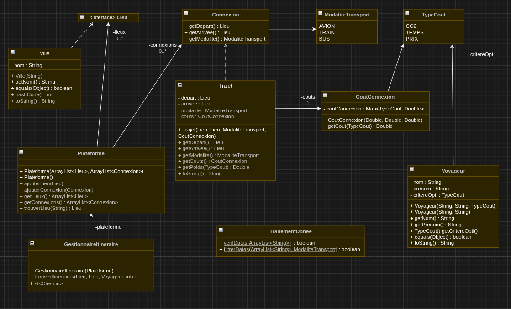

# SAE 2.1/2.2

---
- [SAE 2.1/2.2](#sae-2122)
  - [IHM](#ihm)
  - [Lancement de de l'application](#lancement-de-de-lapplication)
    - [Execution](#execution)
    - [Paramètres d'entrée](#paramètres-dentrée)
    - [Structure du projet](#structure-du-projet)
  - [Conception](#conception)
  - [Logique](#logique)
    - [Filtrage](#filtrage)
    - [Validation des données](#validation-des-données)
    - [Graphes](#graphes)
  - [Tests](#tests)
    - [Cas testés](#cas-testés)

---

## IHM
*Toutes les ressources ainsi que la maquette et le code liés à la partie IHM se trouvent dans le dossier ihm.*

## Lancement de de l'application

### Execution

Pour compiler il faut utiliser `javac -cp "lib/*" -d bin src/poo/*.java`.
*Nous nous étions trompés sur la ligne de compilations dans a versions précédente.*

Pour executer il faut utiliser `java -cp "bin:lib/*" poo.Main <nom> <prenom> <critereOpti> <transport> <tempsMax>`.

### Paramètres d'entrée

Les paramètres à entrer dans l'appli sont les suivants:
- le nom
- le prenom
- le critère à opti
- le moyen de transport
- le temps max

### Structure du projet

*Le projet suit la structure suivante*
  
```
.
├── bin
│   ├── graphes
│   │   └── GraphesV1.class
│   ├── ihm
│   │   ├── Appli.class
│   │   ├── img
│   │   │   ├── favorite.png
│   │   │   ├── history.png
│   │   │   ├── route.png
│   │   │   └── switch.png
│   │   └── maquettes
│   │       └── Maquettes.png
│   └── poo
│       ├── Connexion.class
│       ├── CorrespondanceArete.class
│       ├── CoutConnexion.class
│       ├── GestionnaireItineraire.class
│       ├── Lieu.class
│       ├── LieuModalite.class
│       ├── Main.class
│       ├── Plateforme.class
│       ├── TestCoutConnexion.class
│       ├── TestGestionnaireItineraire.class
│       ├── TestPlateforme.class
│       ├── TestTraitementDonnees.class
│       ├── TestTrajet.class
│       ├── TestVille.class
│       ├── TestVoyageImpossibleException.class
│       ├── TestVoyageur.class
│       ├── TraitementDonnees.class
│       ├── Trajet.class
│       ├── TransportArete.class
│       ├── TypeCout.class
│       ├── Ville.class
│       ├── VoyageImpossibleException.class
│       └── Voyageur.class
├── lib
│   ├── jgrapht-core-1.5.1.jar
│   ├── jheaps-0.14.jar
│   ├── junit-platform-console-standalone-6.0.3.jar
│   └── sae_s2_2026.jar
├── rapport
│   ├── img
│   │   ├── gr1.png
│   │   ├── gr2.png
│   │   └── uml.png
│   ├── RapportGraphes.md
│   ├── RapportGraphes.pdf
│   └── uml.drawio
├── RapportV1.pdf
├── README.md
├── res
│   ├── exemple-correspondances.csv
│   ├── exemple-reseau.csv
│   └── test.csv
├── src
│   ├── graphes
│   │   └── GraphesV1.java
│   ├── ihm
│   │   ├── Appli.java
│   │   ├── img
│   │   │   ├── favorite.png
│   │   │   ├── history.png
│   │   │   ├── route.png
│   │   │   └── switch.png
│   │   └── maquettes
│   │       └── Maquettes.png
│   └── poo
│       ├── Connexion.java
│       ├── CorrespondanceArete.java
│       ├── CoutConnexion.java
│       ├── GestionnaireItineraire.java
│       ├── Lieu.java
│       ├── LieuModalite.java
│       ├── Main.java
│       ├── Plateforme.java
│       ├── TraitementDonnees.java
│       ├── Trajet.java
│       ├── TransportArete.java
│       ├── TypeCout.java
│       ├── Ville.java
│       ├── VoyageImpossibleException.java
│       └── Voyageur.java
└── test
    └── poo
        ├── TestCoutConnexion.java
        ├── TestGestionnaireItineraire.java
        ├── TestPlateforme.java
        ├── TestTraitementDonnees.java
        ├── TestTrajet.java
        ├── TestVille.java
        ├── TestVoyageImpossibleException.java
        └── TestVoyageur.java
```

## Conception



## Logique

### Filtrage

Pour l'instant notre application ne permet que de filtrer les types de transport.

### Validation des données

La fonction verifDatas() traite nos données sous la forme d'une ArrayList
Elle vérifie si:
- la liste n'est pas *null*
- chaque ligne n'est ni *null* ni égale à *""*
- chaque champ séparé de *;* n'est pas vide

La fonction filtrerDatas() filtre par mode de transport.
Elle parcourt toutes les lignes et ajoute les lignes dont le mode de transport correspond à celui selectionné.

### Graphes

Dans notre modélisation, les sommets représentent les villes, les arêtes représentent les connexions et le poid représente le critère choisi à optimiser.

Nous utilisons les lib fournies pour effectuer le calcul.

## Tests

Nous utilisons JUnit pour nos tests et nos tests sont dans le dossier `test/`

### Cas testés

**Voyageur**
| Méthode | Cas testé | Résultat attendu |
|---|---|---|
| `Voyageur(nom, prenom, critere)` | Constructeur entier `"Dupont"`, `"Jean"`, `PRIX` | `getNom()` -> `"Dupont"`, `getPrenom()` -> `"Jean"`, `getCritereOpti()` -> `PRIX` |
| `Voyageur(nom, prenom)` | Constructeur vide `"Martin"`, `"Alice"` | `getCritereOpti()` -> `TEMPS` |
| `equals()` | Comparaison lui-meme (`v1.equals(v1)`) | `true` |
| `equals()` | Critere différent (`v1.equals(v3)`) | `true` |
| `equals()` | Nom et prenom differents (`v1.equals(v2)`) | `false` |
| `equals()` | Comparaison ec `null` | `false` |
| `toString()` | Voyageur `"Dupont"`, `"Jean"`, `PRIX` | La chaîne contient `"Dupont"`, `"Jean"` et `"PRIX"` |

**TraitementDonnees**
| Méthode | Cas testé | Résultat attendu |
|---|---|---|
| `verifDatas()` | Liste ok | `true` |
| `verifDatas()` | Liste `null` | `false` |
| `verifDatas()` | Liste ligne vide `""` | `false` |
| `verifDatas()` | Ligne champ vide `"Paris;;TRAIN;120"` | `false` |
| `verifDatas()` | Ligne dernier champ vide `"Paris;Lyon;TRAIN;"` | `false` |
| `filtrerDatas()` | Filtre `TRAIN` liste (TRAIN, AVION, BUS) | 2 resultats |
| `filtrerDatas()` | Verif premier résultat | Contient `"Paris"` |
| `filtrerDatas()` | Verif second résultat | Contient `"Marseille"` |

**Ville**
| Méthode | Cas testé | Résultat attendu |
|---|---|---|
| `Ville(nom)` / `getNom()` | Construction `"Paris"` | `getNom()` -> `"Paris"` |
| `toString()` | Ville `"Lille"` | `toString()` -> `"Lille"` |
| `equals()` | Deux villes même nom `"Marseille"` | `true` |
| `equals()` | Deux villes noms différents `"Marseille"` et `"Lyon"` | `false` |
| `hashCode()` | Deux villes même nom `"Nice"` | Même valeur de hashCode |

**CoutConnexion**
| Méthode | Cas testé | Résultat attendu |
|---|---|---|
| `CoutConnexion(prix, temps, co2)` | Construction `60.0`, `80.0`, `1.7` | `getCout(PRIX)` -> `60.0` |
| `CoutConnexion(prix, temps, co2)` | Construction `60.0`, `80.0`, `1.7` | `getCout(TEMPS)` -> `80.0` |
| `CoutConnexion(prix, temps, co2)` | Construction `60.0`, `80.0`, `1.7` | `getCout(CO2)` -> `1.7` |
| `CoutConnexion(typeCout, valeur)` | Construction uniquement `PRIX = 50.0` | `getCout(PRIX)` -> `50.0` |
| `CoutConnexion(typeCout, valeur)` | Construction uniquement `PRIX = 50.0` | `getCout(TEMPS)` -> `null` |
| `CoutConnexion(typeCout, valeur)` | Construction uniquement `PRIX = 50.0` | `getCout(CO2)` -> `null` |

**Trajet**
| Méthode | Cas testé | Résultat attendu |
|---|---|---|
| `Trajet(depart, arrivee, modalite, cout)` | Construction TRAIN, AVION et BUS | ok |
| `getDepart()` | Trajet Paris -> Lille en TRAIN | `ville1` (Paris) |
| `getArrivee()` | Trajet Paris -> Lille en TRAIN | `ville2` (Lille) |
| `getModalite()` | Trajet Paris -> Lille en TRAIN | `TRAIN` |
| `getCouts().getCout(PRIX)` | Trajet avec couts `60.0, 80.0, 1.7` | `60.0` |
| `getCouts().getCout(TEMPS)` | Trajet avec couts `60.0, 80.0, 1.7` | `80.0` |
| `getCouts().getCout(CO2)` | Trajet avec couts `60.0, 80.0, 1.7` | `1.7` |
| `toString()` | Trajet Paris -> Lille en TRAIN | `"Paris -> Lille (TRAIN)"` |
| `toString()` | Trajet Marseille -> Lyon en AVION | `"Marseille -> Lyon (AVION)"` |
| `toString()` | Trajet Bordeaux -> Paris en BUS | `"Bordeaux -> Paris (BUS)"` |

**Plateforme**
| Méthode | Cas testé | Résultat attendu |
|---|---|---|
| `Plateforme()` | Plateforme vide | `getLieux().size()` -> `0` et `getConnexions().size()` -> `0` |
| `ajouterLieu()` | Ajout ville `"Paris"` | `getLieux().size()` -> `1` |
| `ajouterLieu()` | Ajout doublon (même ville `"Paris"`) | `getLieux().size()` reste à `1` |
| `ajouterLieu()` | Verif contenu apres ajout | `getLieux().get(0)` -> `paris` |
| `ajouterConnexion()` | Ajout Paris -> Lyon | `getConnexions().size()` -> `1` |
| `ajouterConnexion()` | Verif contenu après ajout | `getConnexions().get(0)` -> le trajet Paris -> Lyon |
| `trouverLieu()` | Recherche ville existante `"Lille"` | Retourne `Lille` |
| `trouverLieu()` | Recherche ville absente `"Marseille"` | `null` |