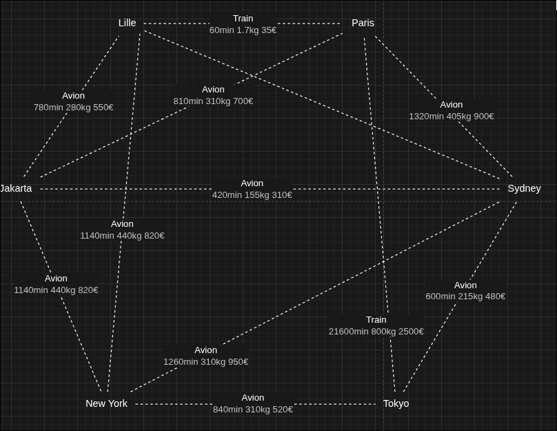

# Rapport SAÉ 2.01-2.02, ressource Graphes

Equipe C2: Erwann Besegher, Alaeddine Oudriss, Jérôme Pardoue, Mehmel Amayas

Lien du repo gitlab: https://gitlab.univ-lille.fr/sae2.01-2.02/2026/C2

## 1 Version 1: Un seul moyen de transport

### 1.1 Exemple

Le schema suivant représente la situations que nous avons modélisé.

Nous avons ensuite dressé le tableau suivant:

| # | Voyage | Mode(s) | Durée (min) | CO₂ (kg éq.) | Prix (€) |
|---|--------|---------|-------------|--------------|----------|
| 1 | Lille – Paris | Train | 60 | 1.7 | 35 |
| 2 | Lille – Jakarta | Avion | 780 | 280 | 550 |
| 3 | Lille – Paris – Jakarta | Train + Avion | 870 | 311.7 | 735 |
| 4 | Lille – New York | Avion | 1140 | 440 | 820 |
| 5 | Jakarta – Sydney | Avion | 420 | 155 | 310 |
| 6 | Jakarta – New York | Avion | 1140 | 440 | 820 |
| 7 | Paris – Sydney | Avion | 1320 | 405 | 900 |
| 8 | Paris – Jakarta | Avion | 810 | 310 | 700 |
| 9 | Paris – Tokyo | Avion | 780 | 290 | 620 |
| 10 | Sydney – Tokyo | Avion | 600 | 215 | 480 |
| 11 | New York – Tokyo | Avion | 840 | 310 | 520 |
| 12 | New York – Sydney | Avion | 1260 | 310 | 950 |
| 13 | Lille – Paris – Sydney | Train + Avion | 1380 | 406.7 | 935 |
| 14 | Lille – Paris – Tokyo | Train + Avion | 840 | 291.7 | 655 |
| 15 | Jakarta – Sydney – Tokyo | Avion + Avion | 1020 | 370 | 790 |

L'utilisatrice de notre scénario choisit l'avion comme moyen de transport et le prix comme critère d'optimisation.

### 1.2 Modèle pour l'exemple

### 1.3 Modélisation pour la version

### 1.4 Prototype pour la Version 1
